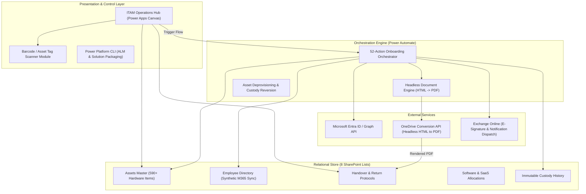
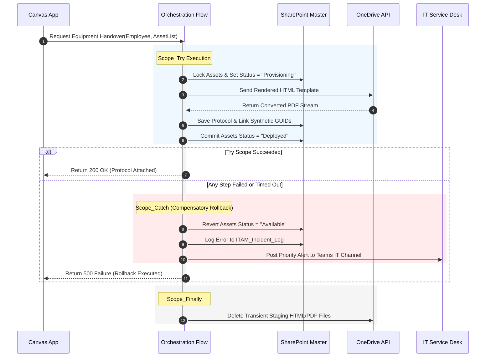

# Enterprise System Architecture & Design Specification

This document outlines the technical design, relational data structures, orchestration pipelines, and security controls powering the **Enterprise IT Asset Management (ITAM) & Employee Onboarding System**.

---

## 1. Component & Data Flow Architecture

The platform provides end-to-end IT lifecycle automation spanning 590+ enterprise assets across 8 interconnected SharePoint lists, integrated with Microsoft 365 User Directory and automated digital protocol generation.

---

## 2. Architecture Decision Records (ADRs)

### ADR-001: Synthetic Foreign Keys & Relational Consistency across 8 SharePoint Lists

* **Status:** Accepted & Verified in Production
* **Context:** The ITAM workflow requires tracking complex relations: 1 Employee has N Assets, 1 Asset has N Lifecycle Maintenance Records, and 1 Handover Protocol binds M Assets to 1 Employee with digital signatures. Native SharePoint Lists lack relational integrity constraints and foreign key enforcement.
* **Decision:**
  * Implement synthetic UUIDs (`Asset_UUID`, `Employee_UPN`, `Protocol_GUID`) stored as indexed single-line text columns.
  * Direct deletions from master lists are disabled via SharePoint UI permissions. Soft-deletes (`IsActive = false`, `LifecycleStatus = "Retired"`) are enforced.
  * Relational cascade updates and custody reassignments are mediated exclusively by the 52-action Power Automate orchestrator, ensuring atomic updates across all 8 tables.

---

### ADR-002: Zero-Cost Headless PDF Generation & Immutable E-Protocols

* **Status:** Accepted & Verified in Production
* **Context:** When issuing laptops, peripherals, and access badges, compliance standards (ISO 27001 / SOC 2) require signed handover acceptance protocols. Third-party PDF generation connectors (Encodian, Adobe PDF Services) required external recurring subscriptions.
* **Decision:**
  * Adopt a native headless rendering pipeline:
    1. Power Automate populates an HTML template containing company branding, employee details, serial numbers, and equipment specs.
    2. The HTML is written to a transient OneDrive staging folder.
    3. The native OneDrive `Convert File (PDF)` action converts the HTML payload to vector PDF.
    4. The generated PDF is committed to the SharePoint `Protocols` document library with immutable metadata and dispatched via email for digital receipt confirmation.
  * **Cost Impact:** $0 additional licensing footprint; 100% tenant-native execution.

---

### ADR-003: Tri-Scope Exception Handling & Compensatory Rollback (Try-Catch-Finally)

* **Status:** Accepted & Verified in Production
* **Context:** An onboarding flow executes 52 individual steps (retrieving Entra ID data, allocating hardware, decrementing inventory, generating PDFs, and sending alerts). An unhandled exception halfway through could leave hardware marked as "Allocated" without an associated employee or protocol.
* **Decision:**
  * Structure the workflow into three explicit execution scopes:
    * **Scope_Try:** Executes the sequential allocation, data patching, and PDF compilation.
    * **Scope_Catch:** Configured with `Run After: Scope_Try has failed, skipped, or timed out`. Executes compensatory rollback (reverts asset status to `Available`, logs error telemetry, and creates an urgent IT Service Desk incident ticket).
    * **Scope_Finally:** Configured with `Run After: Scope_Catch has succeeded`. Flushes transient HTML conversion files and closes session metrics.

---

## 3. Failure Modes & Mitigations Matrix

| Failure Mode | Detection | System Response | Recovery Procedure |
| :--- | :--- | :--- | :--- |
| **Asset Tag Collision** | Duplicate barcode scan during bulk onboarding intake | Power Apps validation formula checks `AssetTag` against indexed master list before form submit | Submit button disabled; inline red indicator highlights conflicting asset |
| **OneDrive PDF Conversion Throttling** | HTTP 429 response from Microsoft Graph / OneDrive API | Exponential backoff retry policy (3 retries, interval 10s, 30s, 60s) | Handled transparently by runtime engine; if max retries exceeded, triggers `Scope_Catch` |
| **Employee Inactive / Offboarded in Entra ID** | O365 Users Connector returns null or `AccountDisabled` | Flow halts allocation prior to inventory mutation | Admin notified with validation prompt to verify employee contract status |
| **Orphaned Hardware Record** | User closes app mid-allocation | Transient state flag with timestamp; automated daily hygiene flow detects records in `Provisioning` > 2h | Daily sweeper resets orphaned assets back to `Available` |

---

## 4. Application Lifecycle Management (ALM)

* **Repository Structure:** Solution source code, canvas component unpacks, and flow definitions are managed via Microsoft Power Platform CLI (`pac solution unpack` / `pac solution pack`).
* **Environment Separation:** Strict isolation between Development tenant, Staging validation, and Production operational tenant with environment variables abstracting SharePoint Site URLs and List GUIDs.
