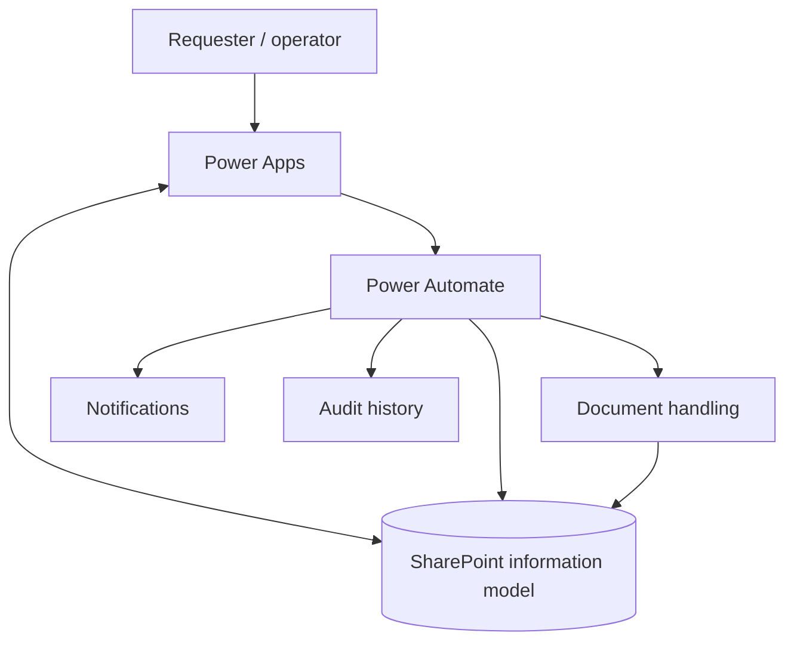

# Architecture | Sanitized Design Walkthrough

> A conceptual view of a low-code asset lifecycle. This is not a production architecture export.

This document focuses on reusable engineering decisions for a business process implemented with Power Platform. It deliberately omits employer identity, ERP references, tenant configuration, internal schema, personal data, precise operating scale, and application-specific connector details.

## Design principles

1. **Separate responsibilities:** keep the app experience, workflow orchestration, and information model understandable as distinct concerns.
2. **Make state visible:** model important lifecycle transitions so users and operators can understand what has happened.
3. **Design for partial failure:** multi-step workflows need explicit recovery behavior; a sequence of actions should not be assumed to be atomic.
4. **Build for governance:** consider role-appropriate access, auditability, data minimization, and controlled reference values.
5. **Keep delivery reviewable:** document solution boundaries and treat low-code components as versioned assets with environment-aware release practices.

## Component and data flow

The diagram is a generalized design view. It does not disclose deployment topology, service endpoints, tenant identifiers, application names, or organization-specific data structures.

## Conceptual information responsibilities

| Area | Purpose |
|---|---|
| Requests | Capture a business need and its lifecycle state |
| Inventory | Represent assets and custody changes |
| People references | Provide context for assignment and handover |
| Handover evidence | Link lifecycle events to generated documentation |
| Configuration and reference values | Keep settings and controlled choices manageable |
| Access roles | Support role-aware user experiences |
| Audit history | Record changes that matter to operations |

These are conceptual areas, not source list names, columns, keys, or an exact physical schema. See the [sanitized model](schema/conceptual-data-model.json).

## Decision records

### Data relationships and lifecycle state

**Decision:** describe business relationships explicitly and use stable references suited to the chosen data store. Keep lifecycle state changes visible, and avoid relying on hard deletion where historical traceability matters.

**Trade-off:** a low-code data store may not enforce every relational constraint natively. Validation and operational safeguards must be designed deliberately; they should not be presented as database guarantees when they are not.

### Document generation and retention

**Decision:** treat generated handover evidence as part of the workflow, with a clear relationship to the lifecycle event and a defined retention location.

**Trade-off:** conversion capabilities, connector behavior, licensing, retention, and access controls depend on the target environment. This repository does not claim a specific implementation or cost.

### Recovery from workflow failures

**Decision:** organize multi-step automation so failures are detected, recorded, and followed by a suitable recovery or compensating action. Keep cleanup and notification behavior explicit.

**Trade-off:** compensating actions reduce inconsistent states but do not make a distributed workflow transactional. Recovery behavior needs testing against the actual platform and business rules.

## Failure considerations

| Failure condition | Design consideration |
|---|---|
| Conflicting or duplicate asset reference | Validate against the current information model and provide a clear correction path |
| Required person or request context unavailable | Stop before changing inventory state and surface an actionable message |
| Document service unavailable | Preserve a visible pending/error state and allow controlled retry or operator recovery |
| A downstream action fails after a state change | Record the failure and apply a compensating action where safe |
| User access does not match the required task | Apply role-aware access and avoid exposing unrelated records |

These are generic scenarios for review, not claims about observed incidents or implemented controls in a specific tenant.

## Application lifecycle management

Low-code applications still benefit from source control, solution packaging, reviewable changes, and environment-aware configuration. Keep secrets, tenant-specific endpoints, personal data, and connection details outside public source. Validate imports and releases in the target environment before operational use.

This public repository contains documentation and a conceptual model only. It is not a deployable solution or a record of a verified production release.
