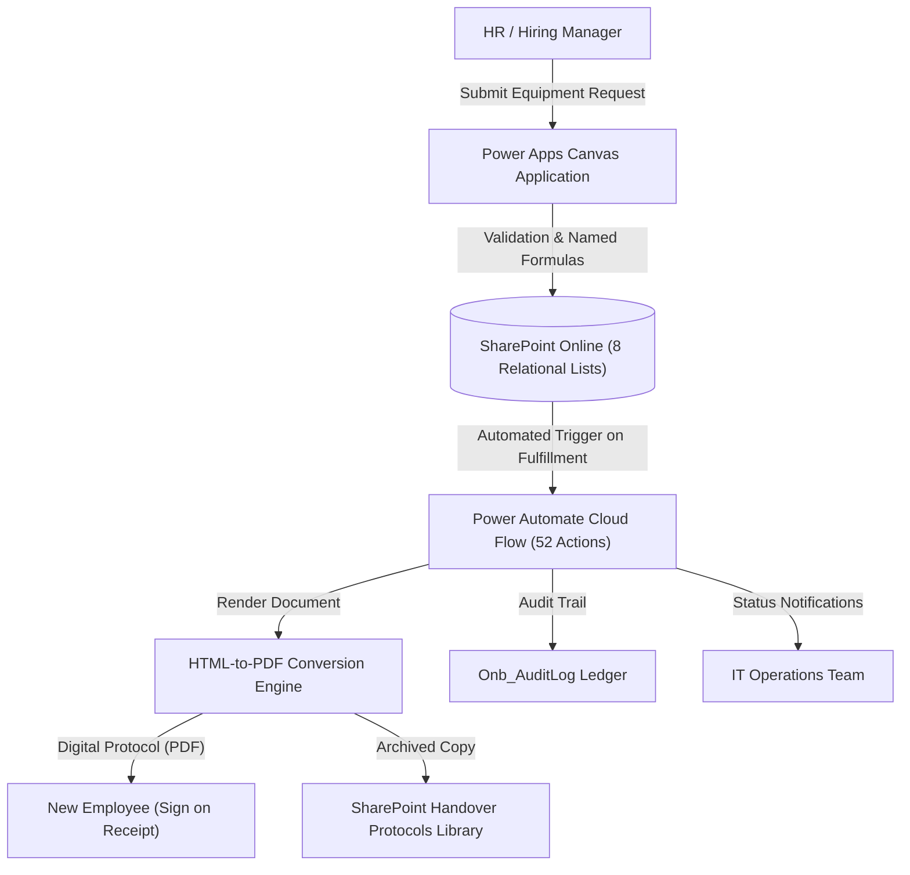

# Enterprise IT Asset Management (ITAM) & Employee Onboarding System

An end-to-end enterprise IT Asset Management and employee lifecycle application built on **Microsoft Power Platform** (Power Apps Canvas, Power Automate, SharePoint Online, and Power Platform CLI `pac`). It tracks **590+ enterprise IT assets** across their full lifecycle and automates employee equipment requests, transfers, offboardings, and digital handover protocols.

> **Portfolio note:** This repository is an architecture showcase and technical documentation. The production application operates within a private enterprise Microsoft 365 tenant. All organization domains, personal names, internal serial numbers, and Active Directory identifiers have been sanitized and replaced with illustrative placeholders (*EnterpriseCorp / user@domain.com*).

---

## Architectural Highlights

* **Cost-Free Enterprise ITAM:** Delivers full IT Asset Management capabilities equivalent to commercial tools (like ServiceNow Asset Management or Jira Assets) strictly using existing Microsoft 365 E3 licenses with **zero additional per-user licensing costs**.
* **52-Action Power Automate Automation:** Orchestrates ticket approvals, automated asset reservation, dynamic HTML-to-PDF handover protocol generation with digital signatures, and multi-party notifications.
* **Relational Schema on SharePoint Lists:** An 8-list normalized relational model (73 total columns) with lookup keys, audit logging, and indexed search.
* **Infrastructure-as-Code (IaC) & ALM:** Deconstructed Canvas application using Microsoft PAC CLI (`pac canvas unpack`) and custom Python build automation, enabling Git version control and PR-based code reviews for low-code assets.

---

## System Architecture



---

## Relational SharePoint Schema (8 Lists)

The backend utilizes 8 interrelated SharePoint Online lists:

| # | List Internal Name | Purpose | Key Attributes |
|---|---|---|---|
| 1 | `Onb_Requests` | Master equipment & change requests | `RequestNo`, `RequestType`, `RequestStatus`, `EmployeeEmail`, `Department`, `StartDate` |
| 2 | `Onb_Assets` | Master hardware inventory (590+ items) | `AssetTag`, `SerialNumber`, `Model`, `AssetCategory`, `CurrentStatus`, `AssignedTo` |
| 3 | `Onb_People` | Internal employee directory cache | `UPN`, `DisplayName`, `Department`, `Location`, `ManagerUPN` |
| 4 | `Onb_Protocols` | Generated handover & return protocols | `ProtocolNo`, `ProtocolType`, `SignDate`, `SignedDocumentUrl` |
| 5 | `Onb_Config` | Dynamic system keys & parameters | `ConfigKey`, `ConfigValue`, `MinLeadDaysNewHire` (5 days) |
| 6 | `Onb_Dictionary` | Normalized lookup dictionaries | `DictCategory` (Job Titles, Hardware Models, Locations) |
| 7 | `Onb_Roles` | Security group mapping & RBAC | `UserUPN`, `RoleName` (Admin, IT_Operator, HR_Editor, ReadOnly) |
| 8 | `Onb_Log` | Immutable system transaction ledger | `ActionType`, `EntityID`, `OldValue`, `NewValue`, `ModifiedBy` |

---

## The 52-Action Power Automate Automation

When an IT technician confirms equipment issuance in the Canvas app, the automated workflow triggers:

1. **Transaction Validation:** Verifies asset availability in `Onb_Assets` and locks items to prevent race conditions.
2. **Dynamic HTML Rendering:** Builds an official equipment transfer protocol injecting employee metadata, asset tags, serial numbers, laptop specifications, and peripheral accessories.
3. **PDF Conversion:** Converts rendered HTML to PDF using OneDrive / SharePoint conversion microservices.
4. **Digital Signature Preparation:** Injects verification hash and signature acceptance blocks for paperless sign-off.
5. **Multi-Channel Distribution:**
   - Archives PDF into SharePoint Protocols document library.
   - Emails encrypted PDF copy to employee and manager.
   - Updates `Onb_Assets` status to `In Use` with linked protocol reference.

---

## Infrastructure-as-Code (PAC CLI & Python Build Tooling)

Unlike typical Canvas apps stored as opaque binary blobs (`.msapp`), this solution was authored with strict ALM discipline:

* **Decompiled YAML Screens:** The application UI is broken down into human-readable `.pa.yaml` screen files (`scrHome.pa.yaml`, `scrAsset.pa.yaml`, `scrNewRequest.pa.yaml`, `scrProtocol.pa.yaml`).
* **Named Formulas:** Centralized business logic and global state defined in `App.Formulas`:
```powerfx
// Centralized state & reactive permissions
fxCurrentUser = User();
fxUserRole = Coalesce(
    LookUp(Onb_Roles, UserUPN = fxCurrentUser.Email).RoleName,
    "StandardUser"
);
fxIsAdmin = fxUserRole = "IT_Admin";
fxIsITOperator = fxUserRole in ["IT_Admin", "IT_Operator"];
```
* **Python Automated Bundler:** A dedicated Python build script (`buduj.py`) assembles UI components, applies property templates, and validates formula syntax before repacking into deployable `.msapp` packages.

---

## Measurable Business Impact

* **590+ Hardware Assets Managed:** Total visibility into laptop models, warranties, and physical locations.
* **100% Paperless Protocols:** Replaced printed paper sign-off sheets with digital PDF protocols.
* **Lead Time Reduced from 5 Days to Instant:** Hiring managers receive automated approval tracking, eliminating back-and-forth emails with IT support.

---

## Author
**Dawid Piotrowski**
* Role: IT Automation & Power Platform Developer
* LinkedIn: [linkedin.com/in/dawid-piotrowski0304](https://linkedin.com/in/dawid-piotrowski0304)
* GitHub: [github.com/Dawiddevops](https://github.com/Dawiddevops)
* Certification: Microsoft Certified: Power Platform Fundamentals (PL-900)
