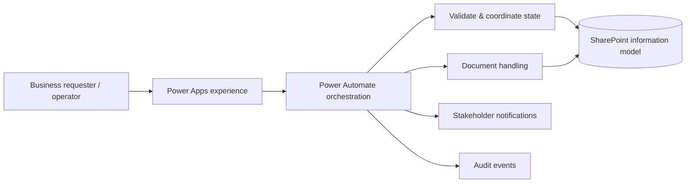
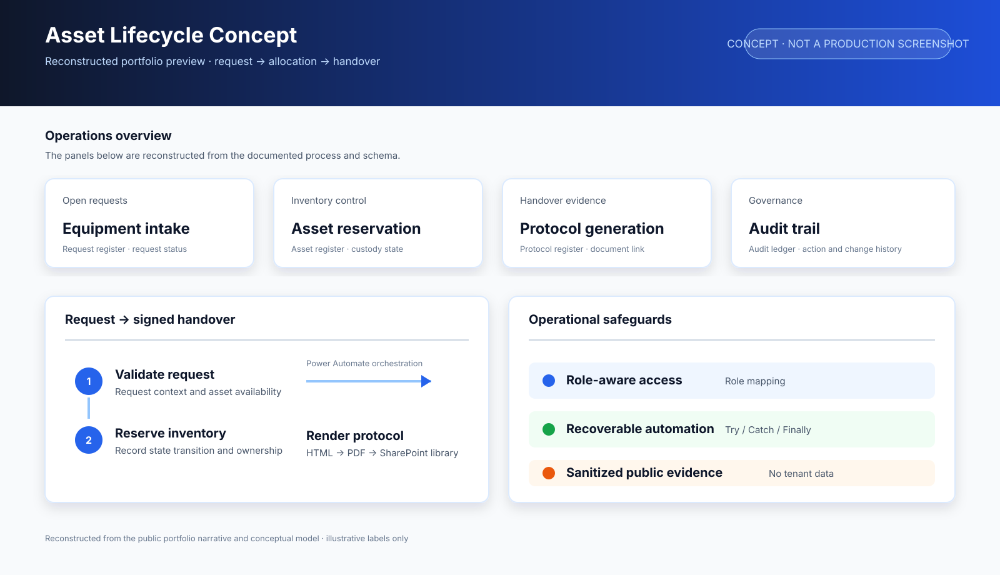

# IT Asset Lifecycle | Power Platform Portfolio Case Study

> **A request is only the beginning. Design the data, workflow, controls, and evidence that make the whole lifecycle understandable.**

This repository presents a **sanitized, documentation-only case study** in Microsoft Power Platform solution design. It explores how a low-code business application can coordinate asset requests, inventory custody, document handling, and auditability without treating the app as just a collection of screens.

**Privacy boundary:** The public materials are conceptual and intentionally omit company identity, ERP products, tenant details, personal information, internal schema names, operational quantities, and production exports. No production application source or screenshots are included.

## The engineering challenge

Equipment lifecycle processes cross requesters, operational teams, inventory records, and handover evidence. When those concerns are handled in disconnected tools, ownership and status can become difficult to trace, and a failure halfway through a process can leave records inconsistent.

This case study frames the solution around three responsibilities:

- **Experience:** collect requests and support operational review in Power Apps.
- **Orchestration:** coordinate validation, state changes, document handling, notifications, and recovery in Power Automate.
- **Information:** organize reference data, inventory, lifecycle records, and audit events using SharePoint.

The emphasis is on the engineering approach: explicit data ownership, reviewable low-code design, role-aware access, and recoverable multi-step workflows.

## Architecture at a glance



The detailed walkthrough, design decisions, and failure considerations are in **[ARCHITECTURE.md](ARCHITECTURE.md)**.

## Conceptual information model

The sanitized model describes business responsibilities, not the source system's table names, field names, keys, or exact schema.

| Information area | Responsibility |
|---|---|
| Requests | Capture lifecycle needs and their progress |
| Inventory | Describe assets and their custody state |
| People references | Support assignment and operational context |
| Handover records | Associate lifecycle events with their evidence |
| Configuration and reference data | Keep controlled options and settings understandable |
| Access roles | Describe role-aware application behavior |
| Audit history | Make important state changes reviewable |

The machine-readable **[conceptual data model](schema/conceptual-data-model.json)** contains only these generalized information areas.

## Design and operational practices

- **Low-code architecture:** separate user experience, workflow orchestration, and information responsibilities.
- **Data modelling:** represent lifecycle records and relationships in a way that can be reviewed and evolved.
- **Failure handling:** plan for partial completion and use compensating actions where a multi-step operation cannot be atomic.
- **Governance:** consider least-privilege roles, audit history, and controlled reference data.
- **ALM awareness:** treat low-code assets as solution components that need source control, environment configuration, and release discipline.
- **Communication:** explain decisions and failure modes through concise architecture documentation.

These are design themes illustrated by the case study, not claims of independently verified production outcomes.

## Visual preview

No source UI screens or production screenshots are published here. The image is a **reconstructed concept illustration** made for this portfolio from the generic architecture described in this repository. It is not a screenshot, deployment artifact, or representation of a named company's application.

[](docs/portfolio-preview.svg)

## Reviewer route

1. Read the challenge and architecture overview above.
2. Review **[ARCHITECTURE.md](ARCHITECTURE.md)** for the design principles and failure-handling approach.
3. Inspect the [conceptual model](schema/conceptual-data-model.json) for its high-level information domains.
4. See **[CONTRIBUTING.md](CONTRIBUTING.md)** for the repository's privacy and validation rules.

## Repository contents

```text
.
├── README.md
├── ARCHITECTURE.md
├── CONTRIBUTING.md
├── docs/
│   └── portfolio-preview.svg
└── schema/
    └── conceptual-data-model.json
```

## Scope and evidence

This repository is a portfolio narrative and conceptual design reference. It does not contain application source, deployment instructions, tenant configuration, live evidence, or measured business outcomes. No claim is made here about a specific employer, ERP, production environment, compliance certification, licensing cost, or operational result.

The public examples are deliberately generalized to protect people and organizational information. Any implementation decision would need validation against the requirements, permissions, licensing, and platform constraints of its target environment.
